# Laporan Praktikum 7: Pemrograman Server-Side dengan PHP

**Mata Kuliah:** Pemrograman Web  
**Program Studi:** Teknik Informatika  
**Direktori Proyek:** `Lab7Web_PHP`  

---

## 👤 Identitas Mahasiswa
| Data | Keterangan |
| :--- | :--- |
| **Nama** | **Rasya Fakhri Akbar** |
| **NIM** | **312310626** |

---

## A. Tujuan Praktikum
1. Memahami perbedaan mendasar antara pemrosesan *client-side* dan *server-side*.
2. Mengenali sintaks dasar PHP dan menjalankan file PHP melalui server web lokal (Laragon / XAMPP).
3. Menguasai variabel, tipe data, operator, percabangan, perulangan, dan custom *function*.
4. Mengimplementasikan penerimaan dan pemrosesan data form HTML menggunakan metode HTTP `GET` dan `POST`.
5. Menerapkan validasi dan sanitasi input (*server-side validation*) untuk keamanan data dan proteksi XSS.
6. Membangun aplikasi mini project penginputan data mahasiswa dengan validasi berlapis dan antarmuka responsif.

---

## B. Perangkat yang Digunakan
- **Sistem Operasi:** Windows (win32)
- **Web Server & Environment:** Laragon (Apache/Nginx & PHP 8.2)
- **Code Editor:** Visual Studio Code
- **Browser:** Google Chrome / Mozilla Firefox / Microsoft Edge

---

## C. Cara Menjalankan Server Lokal & Aplikasi
1. Salin atau letakkan folder `Lab7Web_PHP` di dalam direktori root server lokal Anda:
   - **Laragon:** `C:\laragon\www\Lab7Web_PHP`
   - **XAMPP:** `C:\xampp\htdocs\Lab7Web_PHP`
2. Jalankan aplikasi web server (klik **Start All** pada Laragon/XAMPP).
3. Buka web browser dan akses URL berikut:
   - Menu Utama & Portal Latihan: `http://localhost/Lab7Web_PHP/` atau `http://localhost/Lab7Web_PHP/index.php`

---

## D. Struktur File Proyek
```text
Lab7Web_PHP/
├── img/                    # Folder screenshot dokumentasi (WAJIB DIISI USER)
│   ├── latihan1.png
│   ├── latihan2.png
│   ├── latihan3.png
│   ├── latihan4.png
│   ├── latihan5_get.png
│   ├── latihan6_post.png
│   ├── latihan7.png
│   ├── mini_project_form.png
│   ├── mini_project_valid.png
│   ├── mini_project_invalid.png
│   └── database_table.png
├── index.php               # Halaman portal dashboard praktikum
├── latihan1.php            # Latihan 1: Eksekusi PHP dasar & waktu server
├── latihan2.php            # Latihan 2: Variabel, operator, perhitungan grade nilai
├── latihan3.php            # Latihan 3: Array dan perulangan foreach
├── latihan4.php            # Latihan 4: Custom function, diskon, format rupiah
├── latihan5_get.php        # Latihan 5: Pengiriman data form metode GET & pencarian
├── latihan6_post.php       # Latihan 6: Pengiriman data form metode POST
├── latihan7.php            # Latihan 7: Pengolahan transaksi belanja & validasi numerik
├── mini_project.php        # Mini Project: Form Data Mahasiswa (Validasi Server-Side Lengkap)
├── mahasiswa.sql           # Skema database MySQL & tabel mahasiswa
└── README.md               # Laporan dokumentasi praktikum dan jawaban evaluasi
```

---

## E. Eksperimen Mandiri yang Telah Diselesaikan
1. **Perhitungan Rata-rata Nilai:** Diimplementasikan pada `latihan2.php` dengan rumus `($tugas + $uts + $uas) / 3`.
2. **Pencarian Nama pada Array dengan GET:** Diimplementasikan pada `latihan5_get.php` menggunakan fungsi `array_filter()` dan `stripos()`.
3. **Format Mata Uang Rupiah:** Diimplementasikan pada `latihan4.php` melalui function `formatRupiah()`.
4. **Validasi NIM Angka Murni & Tepat 9 Digit:** Diimplementasikan pada `mini_project.php` menggunakan `ctype_digit($nim) && strlen($nim) === 9`.
5. **Tombol Reset:** Diimplementasikan pada `mini_project.php` untuk mengembalikan form ke kondisi awal bersih.

---

## F. Pengujian Kasus Valid & Tidak Valid (Mini Project)

### 1. Kasus Valid 1
- **Input:**
  - Nama: `Budi Wicaksono`
  - NIM: `210101001` (9 digit angka)
  - Program Studi: `Teknik Informatika`
  - Semester: `4`
  - Email: `budi.wicaksono@kampus.ac.id`
- **Hasil:** Validasi server-side lolos. Form disembunyikan dan sistem menampilkan kartu ringkasan data mahasiswa secara aman dengan `htmlspecialchars()`.

### 2. Kasus Valid 2
- **Input:**
  - Nama: `Siti Nurhaliza`
  - NIM: `220202999` (9 digit angka)
  - Program Studi: `Sistem Informasi`
  - Semester: `1`
  - Email: `siti.nur@domain.com`
- **Hasil:** Validasi server-side lolos dan kartu ringkasan data ditampilkan dengan benar.

### 3. Kasus Tidak Valid 1 (Field Kosong & NIM Bukan Angka)
- **Input:**
  - Nama: *(dikosongkan)*
  - NIM: `21ABC001` (mengandung huruf)
  - Program Studi: `-- Pilih Program Studi --` (kosong)
  - Semester: `0` (kurang dari rentang 1-14)
  - Email: `bukan-email` (format salah)
- **Hasil:** Muncul kotak peringatan berlatar merah muda (*pink*) berisi seluruh daftar kesalahan validasi:
  1. *Nama Lengkap wajib diisi.*
  2. *NIM harus berupa angka murni dan panjangnya tepat 9 digit.*
  3. *Program Studi wajib dipilih.*
  4. *Semester harus berupa angka antara rentang 1 sampai 14.*
  5. *Format Email tidak valid (contoh: user@example.com).*

### 4. Kasus Tidak Valid 2 (NIM Kurang Digit & Semester Lebih dari 14)
- **Input:**
  - Nama: `Andi Pratama`
  - NIM: `12345` (hanya 5 digit)
  - Program Studi: `Teknik Komputer`
  - Semester: `16` (di atas batas 14)
  - Email: `andi@` (tidak lengkap)
- **Hasil:** Muncul kotak peringatan merah muda yang menunjukkan NIM tidak valid (harus 9 digit), Semester di luar rentang, dan Email tidak valid.

   - Aplikasi Mini Project: `http://localhost/Lab7Web_PHP/mini_project.php`
4. *Peringatan:* Jangan membuka file `.php` dengan klik ganda secara langsung di file explorer, karena file PHP wajib di-parse melalui server lokal.

---

## H. Dokumentasi Screenshot (Visualisasi Output)

Berikut adalah bukti visual hasil eksekusi setiap latihan dan mini project yang telah diimplementasikan. Screenshot diambil dari browser (localhost) dan database client (phpMyAdmin/HeidiSQL).

### 1. Latihan 1: Menjalankan PHP
Menampilkan output `echo` dan waktu server real-time menggunakan `date()`.
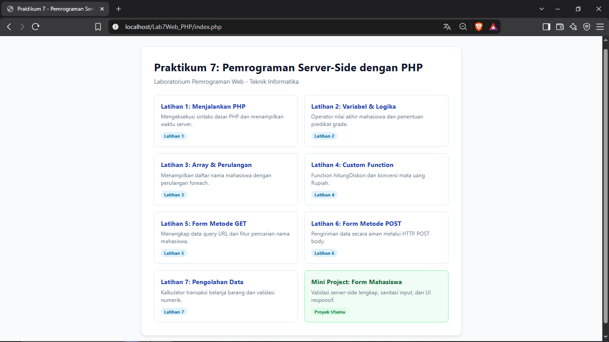

### 2. Latihan 2: Variabel, Operator & Percabangan
Perhitungan nilai akhir terbobot (Tugas 30%, UTS 30%, UAS 40%), penentuan predikat (A-D), serta **Eksperimen Mandiri 1: Rata-rata 3 komponen**.
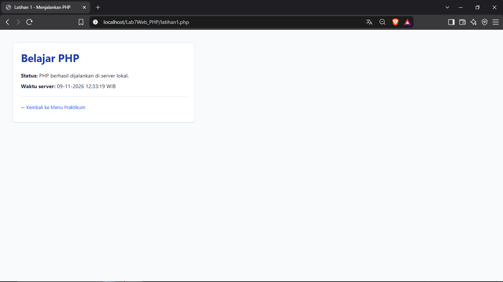

### 3. Latihan 3: Array & Perulangan
Menampilkan daftar 7 nama mahasiswa menggunakan array dan perulangan `foreach`.
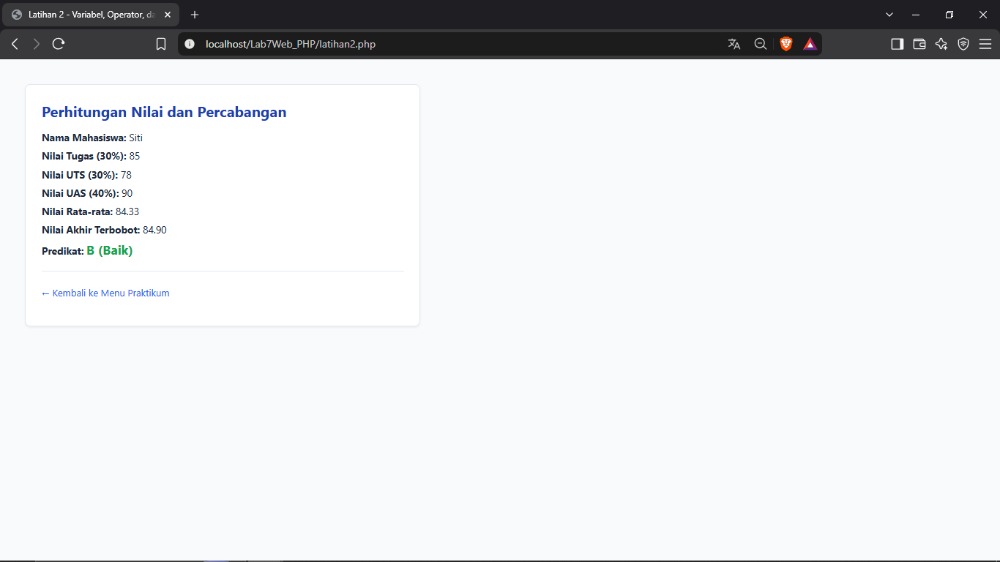

### 4. Latihan 4: Custom Function
Implementasi function `hitungDiskon`, **Eksperimen Mandiri 3: `formatRupiah`**, serta function tambahan luas persegi panjang dan cek kelulusan.
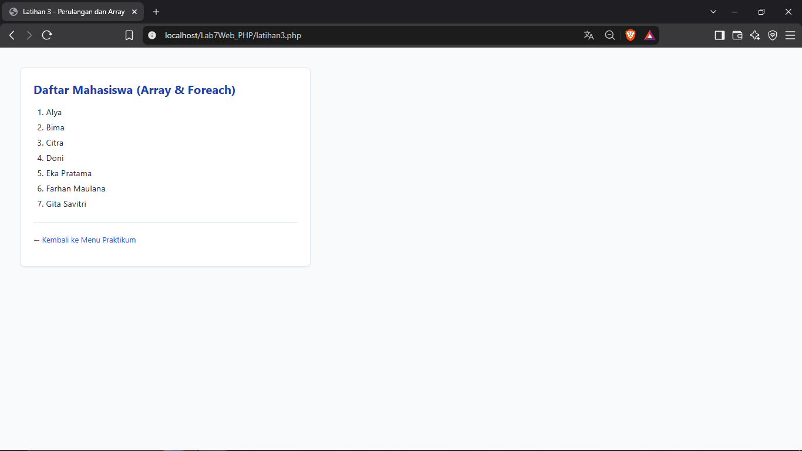

### 5. Latihan 5: Form Metode GET & Pencarian
Form pencarian nama mahasiswa menggunakan method GET. **Eksperimen Mandiri 2: Pencarian array** dengan `array_filter` & `stripos`.
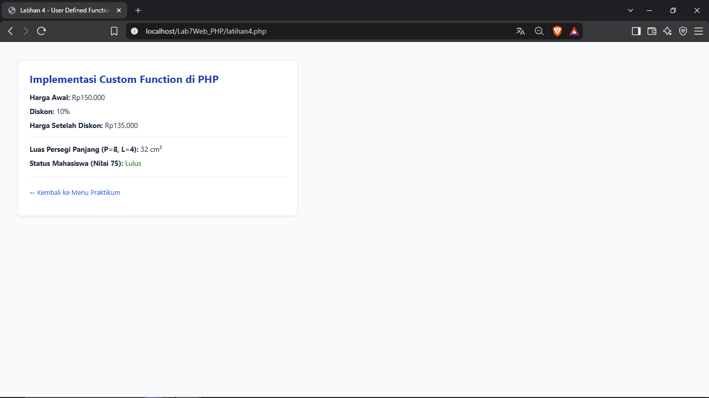

### 6. Latihan 6: Form Metode POST
Pengiriman data nama dan program studi via POST dengan validasi required dan output `htmlspecialchars`.
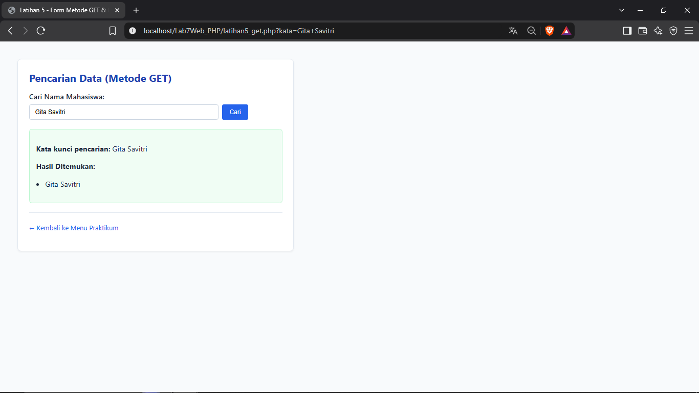

### 7. Latihan 7: Pengolahan Data Transaksi
Form input barang, harga, jumlah. Validasi server-side numerik dan perhitungan subtotal otomatis.
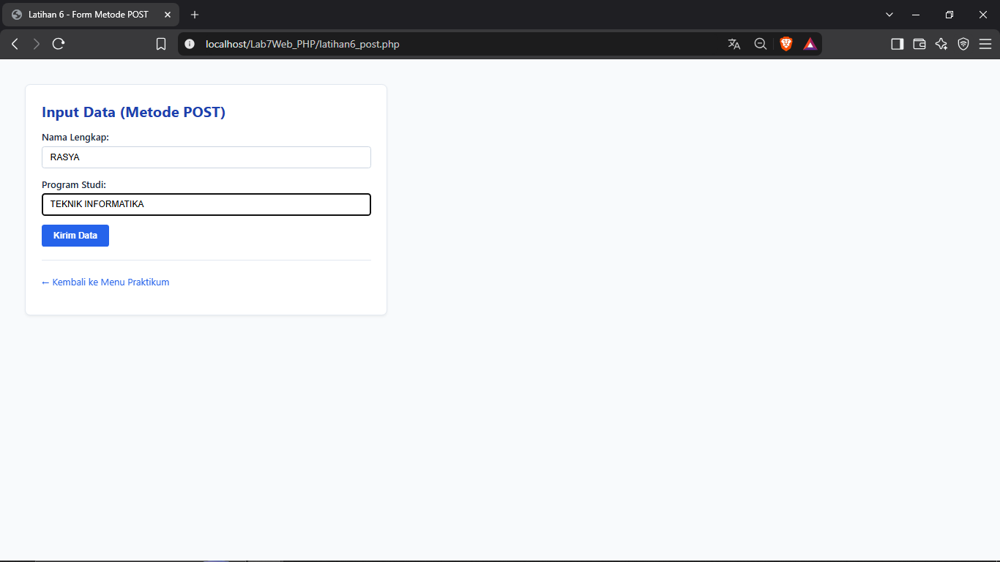

### 8. Mini Project: Form Input Data Mahasiswa (Tampilan Awal)
Form lengkap dengan field: Nama, NIM (validasi 9 digit), Program Studi, Semester (1-14), Email. UI responsif & aksesibel (ARIA).
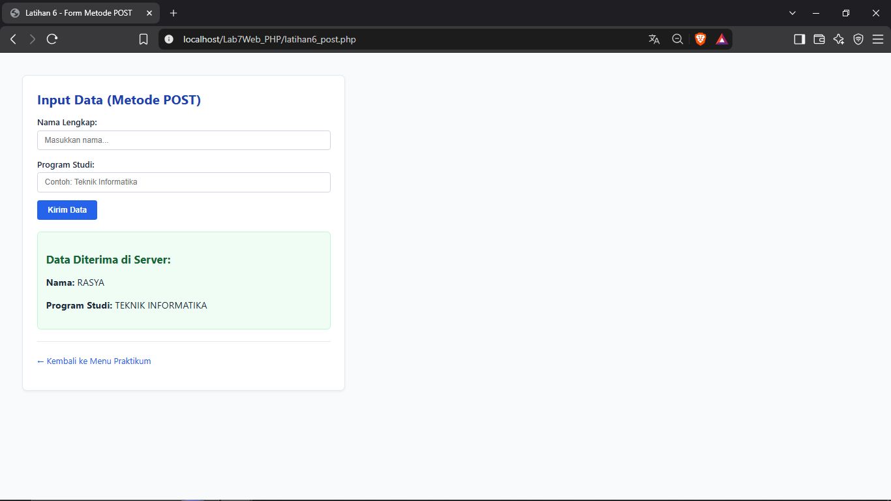

### 9. Mini Project: Validasi Sukses & Ringkasan Data
Data valid (NIM 9 digit angka, Semester 1-14, Email valid) → Tersimpan ke **Database MySQL (PDO Prepared Statement)** → Ditampilkan kartu ringkasan dengan `htmlspecialchars` & timestamp server.
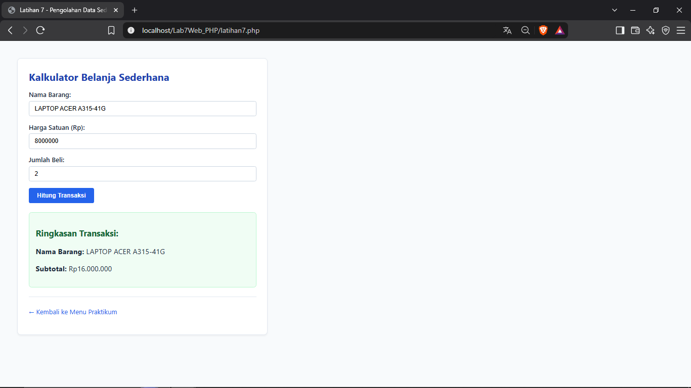

### 10. Mini Project: Validasi Error (Server-Side)
Input tidak valid (NIM bukan angka/kurang digit, Semester 0/16, Email salah format, field kosong) → Muncul **Alert merah muda** (summary) + **Inline feedback merah** per field (aksesibel `aria-invalid`, `aria-describedby`).
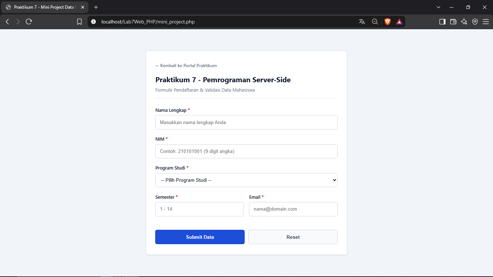

### 11. Database: Tabel `mahasiswa` (phpMyAdmin / HeidiSQL)
Bukti data berhasil tersimpan ke tabel `mahasiswa` di database `praktikum7_db`. Kolom `nim` & `email` bersifat `UNIQUE`.
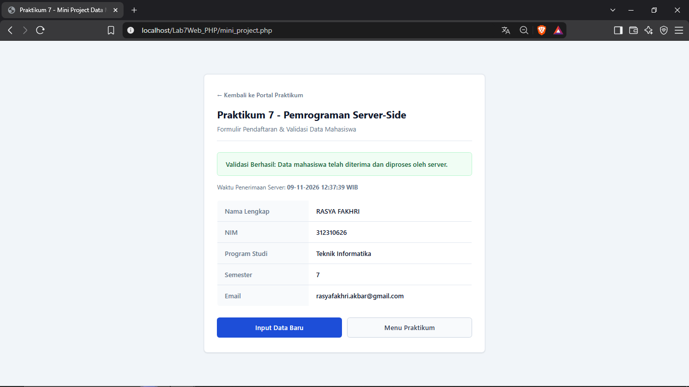

---

## I. Jawaban Pertanyaan Evaluasi Modul

1. **Apa perbedaan pemrosesan client-side dan server-side?**  
   *Jawaban:*  
   - *Client-side* diproses di peramban web (browser) pengguna menggunakan teknologi seperti HTML, CSS, dan JavaScript. Pemrosesan ini fokus pada penyajian tampilan dan interaktivitas langsung.  
   - *Server-side* diproses di komputer server menggunakan bahasa seperti PHP. Server menerima request, menjalankan logika bisnis, memvalidasi data, berkomunikasi dengan database, lalu mengirimkan hasilnya kembali ke browser dalam bentuk HTML/JSON. Kode server-side tidak dapat dilihat langsung oleh pengguna di browser (*inspect element*).

2. **Mengapa file PHP harus dijalankan melalui web server?**  
   *Jawaban:*  
   Karena browser hanya memahami HTML, CSS, dan JavaScript. PHP adalah bahasa pemrograman server-side yang membutuhkan *PHP Interpreter* (yang dikelola web server seperti Apache atau Nginx) untuk mengeksekusi instruksi kodenya menjadi dokumen HTML sebelum dikirimkan ke browser. Jika dibuka langsung (klik ganda), browser hanya akan menampilkan kode PHP mentah sebagai teks biasa atau memicu proses download.

3. **Apa fungsi tanda `$` pada variabel PHP?**  
   *Jawaban:*  
   Tanda dollar (`$`) merupakan penanda sintaksis (*sigil*) wajib dalam PHP yang menyatakan bahwa pengenal (*identifier*) tersebut adalah sebuah variabel. Tanda ini memudahkan parser PHP membedakan variabel dari kata kunci bahasa, nama fungsi, atau konstanta.

4. **Apa perbedaan metode GET dan POST?**  
   *Jawaban:*  
   - **GET:** Mengirimkan data dengan menyematkannya langsung pada URL (*query string*). Cocok untuk operasi pembacaan/pencarian data yang bersifat *idempotent* (tidak mengubah status server). Batas ukuran terbatas dan tidak aman untuk data sensitif seperti kata sandi.  
   - **POST:** Mengirimkan data di dalam *HTTP request body*, sehingga data tidak tampak pada URL peramban. Cocok untuk pengiriman data formulir, data bervolume besar, serta operasi manipulasi data (penyimpanan/pengubahan) yang membutuhkan tingkat privasi lebih tinggi.

5. **Mengapa input pengguna perlu divalidasi di sisi server?**  
   *Jawaban:*  
   Validasi *client-side* (seperti atribut `required` atau JavaScript) dapat dengan mudah dimatikan, dimodifikasi, atau dilewati oleh pengguna teknis (misalnya melalui *Inspect Element*, *Postman*, atau *cURL*). Oleh karena itu, validasi di sisi server (*server-side validation*) adalah baris pertahanan utama yang mutlak diperlukan untuk menjamin integritas data, mencegah kerusakan logika aplikasi, dan menjaga keamanan sistem dari data berbahaya.

6. **Apa fungsi `htmlspecialchars()` ketika menampilkan data dari form?**  
   *Jawaban:*  
   Fungsi `htmlspecialchars()` mengubah karakter-karakter khusus HTML (seperti `<`, `>`, `&`, `"`, dan `'`) menjadi entitas HTML (`&lt;`, `&gt;`, `&amp;`, `&quot;`, `&#039;`). Hal ini mencegah serangan **XSS (Cross-Site Scripting)**, yaitu kondisi di mana penyerang memasukkan skrip JavaScript berbahaya ke dalam input form yang dapat dieksekusi secara tidak sah di browser pengguna lain jika ditampilkan tanpa disaring.

7. **Apa manfaat penggunaan function dalam program PHP?**  
   *Jawaban:*  
   - Menerapkan prinsip **DRY (*Don't Repeat Yourself*)**: kode dapat dipanggil berulang kali tanpa menulis ulang logika yang sama.  
   - **Modularitas & Keterbacaan:** Memecah program besar menjadi bagian-bagian kecil yang terfokus pada satu tugas spesifik (*Single Responsibility*).  
   - **Kemudahan Pemeliharaan (*Maintainability*):** Jika terjadi perubahan logika atau perbaikan bug, pengembang hanya perlu mengubah kode di dalam fungsi tersebut.
